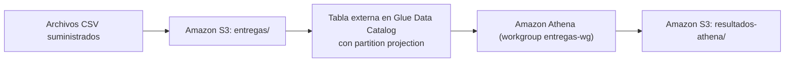

# Entregas de mensajería con S3, Glue (partition projection) y Athena

Proyecto final de Ingeniería de Datos. **Autor:** Pablo Gil.

Una empresa de mensajería recibe cada día un CSV con sus intentos de entrega. Los datos quedan en S3, Glue Data Catalog guarda el esquema y las reglas de **partition projection**, y Athena consulta los CSV. Cada fecha nueva se incorpora **solo subiendo el archivo y consultando**: sin crawlers, sin `MSCK REPAIR TABLE` y sin `ALTER TABLE ADD PARTITION`.

El enunciado original del docente está en [ENUNCIADO.md](ENUNCIADO.md).



## Resumen de resultados

| Etapa | Comprobación | Resultado |
| --- | --- | --- |
| Inicial (días 1 y 2) | Registros en la tabla | 12, en [verificacion_total_tabla.csv](resultados/inicial/verificacion_total_tabla.csv) |
| Inicial | Día 3 proyectado, pero sin archivo | 0 registros, en [verificacion_tercer_dia_antes_de_carga.csv](resultados/inicial/verificacion_tercer_dia_antes_de_carga.csv) |
| Inicial | Intentos, porcentaje y duración contra `resultados_esperados/*_inicial` y `duracion_promedio_2026-10-02.csv` | Idénticos (`diff` sin diferencias) |
| Final (día 3) | Registros del 2026-10-03 | 6, en [verificacion_tercer_dia.csv](resultados/final/verificacion_tercer_dia.csv) |
| Final | Conteo por estado del día 3 | 3 ausente / 1 dirección incorrecta / 2 entregado, en [verificacion_tercer_dia_conteo_estado.csv](resultados/final/verificacion_tercer_dia_conteo_estado.csv) |
| Final | Total de la tabla | 18 registros, 3 fechas, en [verificacion_total_tabla.csv](resultados/final/verificacion_total_tabla.csv) |
| Final | Intentos y porcentaje contra `resultados_esperados/*_final` | Idénticos (`diff` sin diferencias) |
| Final | Particiones registradas en Glue / cambios en Terraform | `[]` / ninguno, en [cargas_s3.txt](evidencias/cargas_s3.txt) |

Todos los IDs de ejecución de Athena están en [evidencias/ejecuciones_athena.csv](evidencias/ejecuciones_athena.csv).

## Estructura del repositorio

```text
├── README.md                     # este archivo: instrucciones reproducibles
├── ENUNCIADO.md                  # enunciado del docente
├── .gitignore                    # excluye credenciales, *.tfstate* y .terraform/
├── infraestructura/
│   ├── principal.tf              # proveedor AWS, S3, Glue (BD + tabla con projection), workgroup Athena
│   ├── variables.tf              # región, nombres, prefijos y rango de fechas
│   ├── salidas.tf                # outputs: bucket, base de datos, tabla y workgroup
│   └── .terraform.lock.hcl       # versión fijada del proveedor
├── consultas/
│   ├── intentos_por_fecha_estado.sql
│   ├── porcentaje_exito_por_fecha_ciudad.sql
│   ├── duracion_promedio_2026-10-02.sql
│   ├── verificacion_tercer_dia.sql      # 4 consultas: registros, conteo por estado, por fecha y total
│   └── verificacion_inicial.sql         # adicional: 12 registros y día 3 aún vacío
├── scripts/
│   └── ejecutar_consulta.sh      # ejecuta un .sql en Athena, descarga el resultado y registra el ID
├── resultados/
│   ├── inicial/                  # resultados de Athena con los días 1 y 2
│   └── final/                    # resultados de Athena con los tres días
├── evidencias/
│   ├── aplicacion_terraform.txt  # salida de terraform apply
│   ├── outputs.json              # terraform output -json
│   ├── cargas_s3.txt             # cargas por etapa, listado de S3, get-partitions y terraform plan
│   ├── ejecuciones_athena.csv    # etapa, archivo_sql, id_ejecucion, archivo_resultado
│   └── eliminacion_terraform.txt # vaciado del bucket y terraform destroy
├── respuestas.md                 # preguntas conceptuales
├── data/entregas/                # CSV suministrados (sin modificar)
└── resultados_esperados/         # referencias suministradas (no se suben a S3)
```

## 1. Prerrequisitos

Probado en **WSL 2 con Ubuntu 24.04** con:

| Herramienta | Versión usada |
| --- | --- |
| Terraform | 1.16.5 (proveedor `hashicorp/aws` ~> 6.0) |
| AWS CLI | v2 (2.36) |
| Bash, `diff`, `sha256sum` | Los de Ubuntu |

- Una cuenta de AWS con un usuario IAM de trabajo (aquí `user_cli`, nunca la cuenta raíz). Necesita permisos sobre S3, Glue (`glue:*Database*`, `glue:*Table*`, `glue:GetPartitions`), Athena (`athena:*WorkGroup*`, `athena:StartQueryExecution`, `athena:GetQueryExecution`) y `sts:GetCallerIdentity`.
- Credenciales configuradas con `aws configure`. Se guardan en `~/.aws/`, fuera del repositorio, y nunca se publican.
- **Región:** `us-east-2` (Ohio). Se cambia con la variable `region`.

```bash
aws configure                 # Access Key del usuario IAM, región us-east-2, salida json
aws sts get-caller-identity   # comprobar la identidad antes de desplegar
```

Todos los comandos siguientes se ejecutan **desde la raíz del repositorio**.

## 2. Configuración

Las variables de [infraestructura/variables.tf](infraestructura/variables.tf) ya tienen valores por defecto. No hace falta un archivo `.tfvars`.

| Variable | Valor por defecto | Uso |
| --- | --- | --- |
| `region` | `us-east-2` | Región de todos los recursos |
| `prefijo_bucket` | `de-final-entregas` | El bucket se llama `<prefijo>-<id de cuenta>` para que el nombre sea único |
| `nombre_base_datos` | `mensajeria` | Base de datos de Glue |
| `nombre_tabla` | `entregas` | Tabla externa |
| `nombre_workgroup` | `entregas-wg` | Workgroup de Athena |
| `prefijo_datos` | `entregas/` | Prefijo de los CSV |
| `prefijo_resultados` | `resultados-athena/` | Prefijo de los resultados de Athena |
| `rango_fechas` | `2026-10-01,2026-10-03` | Rango proyectado (ambos extremos incluidos) |

### Recursos que crea Terraform ([principal.tf](infraestructura/principal.tf))

1. **Bucket S3 privado** `de-final-entregas-<cuenta>`, con bloqueo total de acceso público (`aws_s3_bucket_public_access_block`), `BucketOwnerEnforced` (sin ACL) y cifrado SSE-S3. Los prefijos `entregas/` y `resultados-athena/` son parte de las claves de los objetos y no se crean como carpetas.
2. **Base de datos de Glue** `mensajeria`.
3. **Tabla externa** `mensajeria.entregas`:
   - Columnas en el orden del CSV: `id_envio string`, `ciudad string`, `transportadora string`, `estado string`, `duracion_minutos int`.
   - `LazySimpleSerDe` con `field.delim = ","` y `skip.header.line.count = 1`, para omitir el encabezado de cada archivo. Se eligió este SerDe en lugar de `OpenCSVSerde` porque este último lee todas las columnas como texto, y `duracion_minutos` debe ser `int`.
   - Clave de partición `fecha string`, separada de las columnas del archivo.
   - Partition projection: `projection.enabled=true`, `projection.fecha.type=date`, `projection.fecha.format=yyyy-MM-dd`, `projection.fecha.range=2026-10-01,2026-10-03`, `projection.fecha.interval=1`, `projection.fecha.interval.unit=DAYS`.
   - `storage.location.template = s3://<bucket>/entregas/fecha=${fecha}/`. Es el prefijo de la partición, terminado en `/`, y dentro de él está `entregas.csv`.
   - Terraform **no crea ninguna partición individual**.
4. **Workgroup de Athena** `entregas-wg`, con resultados en `s3://<bucket>/resultados-athena/` y `enforce_workgroup_configuration = true`, para que toda consulta del workgroup escriba ahí.
5. **Outputs** ([salidas.tf](infraestructura/salidas.tf)): `bucket`, `bucket_arn`, `ruta_datos`, `ruta_resultados_athena`, `base_datos_glue`, `tabla_glue`, `tabla_completa`, `workgroup_athena` y `region`.

## 3. Despliegue

```bash
terraform -chdir=infraestructura init
terraform -chdir=infraestructura plan          # 7 recursos por crear
terraform -chdir=infraestructura apply -no-color | tee evidencias/aplicacion_terraform.txt
terraform -chdir=infraestructura output -json > evidencias/outputs.json
```

Comprobar las propiedades de proyección de la tabla:

```bash
aws glue get-table --database-name mensajeria --name entregas --query 'Table.Parameters'
```

Evidencias: [aplicacion_terraform.txt](evidencias/aplicacion_terraform.txt) y [outputs.json](evidencias/outputs.json).

## 4. Ejecución de consultas

Las consultas se ejecutan con [scripts/ejecutar_consulta.sh](scripts/ejecutar_consulta.sh). Para cada consulta del archivo `.sql`, el script:

1. Lanza la consulta en el workgroup `entregas-wg` (`aws athena start-query-execution`).
2. Espera a que termine (`get-query-execution`).
3. Descarga el CSV que Athena escribió en `s3://<bucket>/resultados-athena/<id>.csv`.
4. Quita las comillas dobles que agrega Athena, para dejar el mismo formato de `resultados_esperados/`. Los datos no tienen comas ni comillas internas.
5. Agrega una fila a `evidencias/ejecuciones_athena.csv` con `etapa,archivo_sql,id_ejecucion,archivo_resultado` y rutas relativas a la raíz.

```bash
bash scripts/ejecutar_consulta.sh <inicial|final> <archivo.sql> <resultado.csv> [resultado2.csv ...]
```

Las mismas consultas también se pueden pegar en el editor de Athena de la consola, seleccionando el workgroup `entregas-wg`.

### Decisiones de las consultas

- **Intentos** ([SQL](consultas/intentos_por_fecha_estado.sql)): `COUNT(*)` agrupado por `fecha, estado` y ordenado por ambos de forma ascendente.
- **Porcentaje de éxito** ([SQL](consultas/porcentaje_exito_por_fecha_ciudad.sql)): `100.0E0 * SUM(CASE WHEN estado='entregado' THEN 1 ELSE 0 END) / COUNT(*)`. El literal `DOUBLE` evita la división entera y el denominador incluye todos los estados. Se redondea con `ROUND(...,2)` y se convierte a `DECIMAL(5,2)` para que siempre aparezcan dos decimales.
- **Duración promedio** ([SQL](consultas/duracion_promedio_2026-10-02.sql)): `AVG` solo sobre `estado='entregado'` del `2026-10-02`, para que los ceros de los intentos fallidos no entren en el promedio. Resultado en `DECIMAL(10,2)`.
- Las consultas agregadas **no filtran por fecha**. Athena recorre todo el rango proyectado y solo devuelve las fechas que tienen datos. Por eso el mismo SQL sirve para las dos etapas sin cambiarlo.

## 5. Etapa inicial: días 1 y 2

Se cargan **solo** los dos primeros archivos, uno por uno. No se hace carga recursiva:

```bash
BUCKET=$(terraform -chdir=infraestructura output -raw bucket)

aws s3 cp data/entregas/fecha=2026-10-01/entregas.csv s3://$BUCKET/entregas/fecha=2026-10-01/entregas.csv
aws s3 cp data/entregas/fecha=2026-10-02/entregas.csv s3://$BUCKET/entregas/fecha=2026-10-02/entregas.csv
aws s3 ls s3://$BUCKET/entregas/ --recursive        # solo 2 objetos
```

Consultas de la etapa inicial:

```bash
bash scripts/ejecutar_consulta.sh inicial consultas/intentos_por_fecha_estado.sql         resultados/inicial/intentos_por_fecha_estado.csv
bash scripts/ejecutar_consulta.sh inicial consultas/porcentaje_exito_por_fecha_ciudad.sql resultados/inicial/porcentaje_exito_por_fecha_ciudad.csv
bash scripts/ejecutar_consulta.sh inicial consultas/duracion_promedio_2026-10-02.sql      resultados/inicial/duracion_promedio_2026-10-02.csv

# Adicional: 12 registros, y el día 3 está proyectado pero todavía no tiene datos
bash scripts/ejecutar_consulta.sh inicial consultas/verificacion_inicial.sql \
  resultados/inicial/verificacion_total_tabla.csv \
  resultados/inicial/verificacion_tercer_dia_antes_de_carga.csv
```

Comparación con las referencias (sin salida = idénticos):

```bash
diff resultados/inicial/intentos_por_fecha_estado.csv         resultados_esperados/intentos_por_fecha_estado_inicial.csv
diff resultados/inicial/porcentaje_exito_por_fecha_ciudad.csv resultados_esperados/porcentaje_exito_por_fecha_ciudad_inicial.csv
diff resultados/inicial/duracion_promedio_2026-10-02.csv      resultados_esperados/duracion_promedio_2026-10-02.csv
```

## 6. Etapa final: incorporación del día 3

**No se modifica la infraestructura ni la tabla.** Solo se sube el archivo y se consulta:

```bash
aws s3 cp data/entregas/fecha=2026-10-03/entregas.csv s3://$BUCKET/entregas/fecha=2026-10-03/entregas.csv
```

No se ejecutan crawlers, `MSCK REPAIR TABLE` ni `ALTER TABLE ADD PARTITION`, y no se cambia ninguna propiedad. Para demostrarlo, en [evidencias/cargas_s3.txt](evidencias/cargas_s3.txt) se guardó lo siguiente:

```bash
aws glue get-partitions --database-name mensajeria --table-name entregas    # "Partitions": []
terraform -chdir=infraestructura plan -detailed-exitcode                    # exit code 0: sin cambios
```

Además, se comparó el SHA-256 de la definición de la tabla (`StorageDescriptor`, `Parameters`, `PartitionKeys`) antes y después de la carga, y es el mismo.

Verificación del tercer día y consultas agregadas sobre los tres días:

```bash
bash scripts/ejecutar_consulta.sh final consultas/verificacion_tercer_dia.sql \
  resultados/final/verificacion_tercer_dia.csv \
  resultados/final/verificacion_tercer_dia_conteo_estado.csv \
  resultados/final/verificacion_registros_por_fecha.csv \
  resultados/final/verificacion_total_tabla.csv

bash scripts/ejecutar_consulta.sh final consultas/intentos_por_fecha_estado.sql         resultados/final/intentos_por_fecha_estado.csv
bash scripts/ejecutar_consulta.sh final consultas/porcentaje_exito_por_fecha_ciudad.sql resultados/final/porcentaje_exito_por_fecha_ciudad.csv

diff resultados/final/intentos_por_fecha_estado.csv         resultados_esperados/intentos_por_fecha_estado_final.csv
diff resultados/final/porcentaje_exito_por_fecha_ciudad.csv resultados_esperados/porcentaje_exito_por_fecha_ciudad_final.csv
```

| Archivo de resultado | Contenido |
| --- | --- |
| `resultados/final/verificacion_tercer_dia.csv` | Los 6 registros del 2026-10-03 (ENV-013 a ENV-018) |
| `resultados/final/verificacion_tercer_dia_conteo_estado.csv` | Conteo por estado del 2026-10-03 |
| `resultados/final/verificacion_registros_por_fecha.csv` | 6 registros por cada una de las 3 fechas |
| `resultados/final/verificacion_total_tabla.csv` | 18 registros, 3 fechas, 18 envíos únicos |
| `resultados/final/intentos_por_fecha_estado.csv` | 9 filas, idéntico a la referencia final |
| `resultados/final/porcentaje_exito_por_fecha_ciudad.csv` | 6 filas, idéntico a la referencia final |

El promedio de duración sigue siendo del día 2 y mantiene su referencia, así que no se vuelve a ejecutar.

## 7. Limpieza

Primero se guardan y se versionan todas las evidencias. Después se vacía el bucket (datos y resultados de Athena) y se eliminan todos los recursos con Terraform:

```bash
BUCKET=$(terraform -chdir=infraestructura output -raw bucket)
{
  aws s3 rm s3://$BUCKET --recursive                      # entregas/ y resultados-athena/
  terraform -chdir=infraestructura destroy -auto-approve -no-color
} 2>&1 | tee evidencias/eliminacion_terraform.txt
```

El workgroup tiene `force_destroy = true`, así que Terraform también lo elimina aunque tenga historial de consultas. Para comprobar que no quedó nada:

```bash
aws s3api head-bucket --bucket $BUCKET                    # debe responder 404 / Not Found
aws glue get-database --name mensajeria                   # EntityNotFoundException
aws athena get-work-group --work-group entregas-wg        # InvalidRequestException
```

Evidencia: [eliminacion_terraform.txt](evidencias/eliminacion_terraform.txt).

## 8. Seguridad

- No hay credenciales en el repositorio. Terraform y la CLI usan el perfil de `~/.aws/`.
- `.gitignore` excluye `.terraform/`, `*.tfstate`, `*.tfstate.*`, `*.tfvars`, planes, `.env`, `*.pem` y archivos de llaves de acceso.
- El bucket es privado: tiene bloqueo de acceso público y no usa ACL.

## 9. Uso de IA

Este trabajo se desarrolló con apoyo de Claude Code (Anthropic), lo cual el curso permite. El hilo completo de la conversación se envía al docente junto con la entrega.
